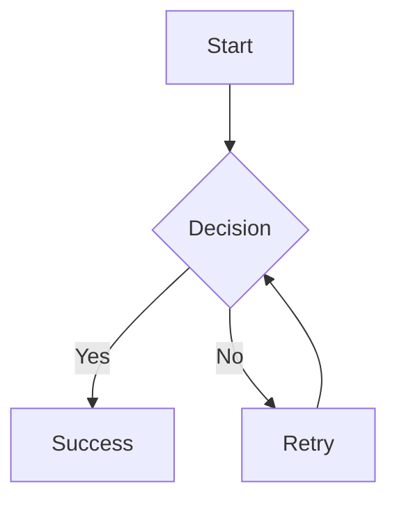

# Test Document

## Features Test

### 1. Lists
- Bullet point 1
- Bullet point 2
  - Nested item
  - Another nested

1. Numbered item
2. Second item

### 2. Code Block
```python
def hello_world():
    print("Hello from code block!")
    return 42
```

### 3. Table
| Feature | Status |
|---------|--------|
| Tables  | ✅     |
| Math    | ✅     |
| Diagrams| ✅     |

### 4. LaTeX Math
Inline math: $E = mc^2$

Block math:
$$\frac{-b \pm \sqrt{b^2-4ac}}{2a}$$

### 5. Mermaid Diagram


### 6. Checkboxes
- [x] Completed task
- [ ] Pending task
- [ ] Another task

### 7. Links & Images
[GitHub](https://github.com)

**Bold text** and *italic text* and ~~strikethrough~~

<!-- hub-related:start -->
⬆ [Markdown to Word](../Markdown%20to%20Word.md)

## Voir aussi

_Liens générés par `hub-related` (GLaDOS), entre ces balises._

- [test_simple](../tests/Archived%20Tests/test_simple.md) — Test Markdown vers Word couvrant listes, cases, maths et diagrammes.
- [FAILING_FEATURES_REPORT](../tests/FAILING_FEATURES_REPORT.md) — Rapport des fonctionnalités Markdown non converties correctement en Word.
- [stress_test_all_features](../tests/stress_test_all_features.md) — Test exhaustif du rendu Markdown vers Word, complémentaire de la note.
- [PIPELINE_OVERVIEW](../Documentation/PIPELINE_OVERVIEW.md) — Vue d'ensemble de l'architecture de l'application Streamlit convertissant Markdown en DOCX et PDF avec gestion des diagrammes Mermaid.
- [QUICK_TEST_GUIDE](../Documentation/QUICK_TEST_GUIDE.md) — Guide de test rapide et de dépannage pour l'application Streamlit de conversion Markdown vers PDF.
<!-- hub-related:end -->
