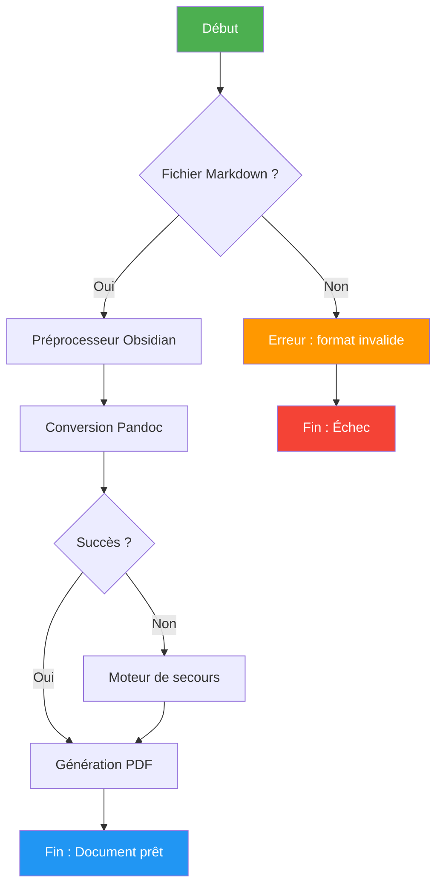
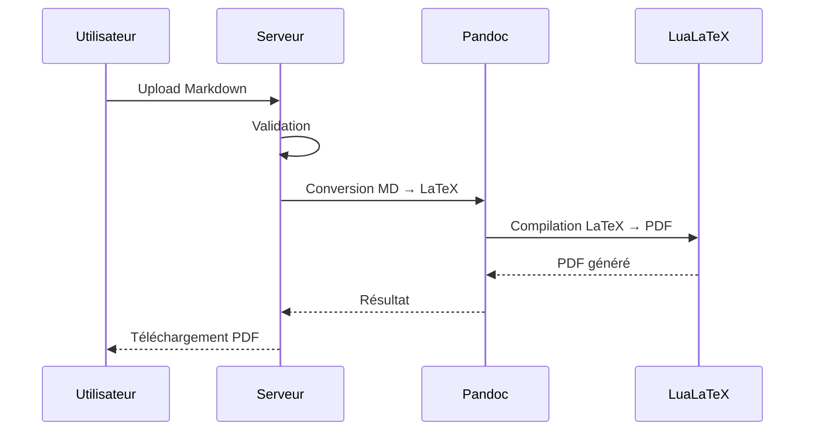

# Stress Test : Toutes les fonctionnalités Markdown

Ce document teste exhaustivement toutes les fonctionnalités de rendu Markdown supportées par le convertisseur.

---

## 1. Styles de texte de base

### 1.1 Emphase et mise en forme

Texte normal sans aucune mise en forme.

*Texte en italique avec astérisques*

_Texte en italique avec underscores_

**Texte en gras avec astérisques**

__Texte en gras avec underscores__

***Texte en gras et italique avec astérisques***

___Texte en gras et italique avec underscores___

**_Texte en gras puis italique combiné_**

*__Texte en italique puis gras combiné__*

~~Texte barré (strikethrough)~~

==Texte surligné (highlighting Obsidian)==

<u>Texte souligné (underline)</u>

`Code en ligne (inline code)`

Texte avec un exposant : x^2^ + y^2^ = z^2^

Texte avec un indice : H~2~O est la formule de l'eau

### 1.2 Combinaisons complexes

**Gras avec du `code en ligne` à l'intérieur**

*Italique avec du ~~barré~~ à l'intérieur*

~~Barré avec du **gras** à l'intérieur~~

==Surligné avec du *italique* à l'intérieur==

**Gras avec *italique* et `code` et ~~barré~~ ensemble**

### 1.3 Liens et références

[Lien simple](https://www.example.com)

[Lien avec titre](https://www.example.com "Titre du lien")

<https://www.example.com>

[Lien en référence][ref1]

[ref1]: https://www.example.com "Référence 1"

### 1.4 Images


### 1.5 Notes de bas de page

Ceci est un texte avec une note de bas de page[^1] et une autre[^2].

[^1]: Première note de bas de page avec du **gras**.
[^2]: Deuxième note de bas de page avec du *italique*.

---

## 2. Titres (tous les niveaux)

# Titre de niveau 1
## Titre de niveau 2
### Titre de niveau 3
#### Titre de niveau 4
##### Titre de niveau 5
###### Titre de niveau 6

---

## 3. Listes

### 3.1 Liste non ordonnée

- Élément 1
- Élément 2
  - Sous-élément 2.1
  - Sous-élément 2.2
    - Sous-sous-élément 2.2.1
    - Sous-sous-élément 2.2.2
- Élément 3

### 3.2 Liste ordonnée

1. Premier élément
2. Deuxième élément
   1. Sous-élément 2.1
   2. Sous-élément 2.2
      1. Sous-sous-élément 2.2.1
      2. Sous-sous-élément 2.2.2
3. Troisième élément

### 3.3 Liste de tâches (checkboxes)

- [ ] Tâche non complétée
- [x] Tâche complétée
- [/] Tâche en cours
- [-] Tâche annulée
- [!] Tâche importante
- [?] Tâche en question
- [>] Tâche reportée
- [<] Tâche planifiée
- [*] Tâche favorite
- [n] Tâche notée
- [l] Tâche lieu
- [i] Tâche info
- [S] Tâche sauvegardée
- [p] Tâche positive
- [c] Tâche complète
- [b] Tâche bookmark
- [f] Tâche fire
- [k] Tâche clé
- [w] Tâche victoire
- [u] Tâche up
- [d] Tâche down

### 3.4 Liste de définitions

Terme 1
:   Définition du terme 1

Terme 2
:   Définition du terme 2
:   Deuxième définition du terme 2

---

## 4. Citations (Blockquotes)

> Citation simple sur une ligne.

> Citation sur
> plusieurs lignes
> qui continue.

> Citation de premier niveau
>
> > Citation imbriquée de deuxième niveau
> >
> > > Citation imbriquée de troisième niveau

> **Citation avec du gras** et *de l'italique* et `du code`.

---

## 5. Callouts Obsidian

> [!note] Note
> Ceci est une note informative.

> [!tip] Astuce
> Ceci est une astuce utile.

> [!warning] Attention
> Ceci est un avertissement important.

> [!danger] Danger
> Ceci est un message de danger critique.

> [!info] Information
> Ceci est une information complémentaire.

> [!success] Succès
> L'opération a réussi.

> [!question] Question
> Avez-vous des questions ?

> [!example] Exemple
> Voici un exemple concret.

> [!abstract] Résumé
> Voici le résumé du document.

> [!bug] Bug
> Un bug a été trouvé dans le système.

> [!quote] Citation
> "La seule façon de faire du bon travail est d'aimer ce que vous faites." — Steve Jobs

> [!failure] Échec
> L'opération a échoué.

---

## 6. Blocs de code

### 6.1 Code en ligne

Utilisez la commande `git commit -m "message"` pour valider vos changements.

### 6.2 Bloc de code sans langage

```
Ceci est un bloc de code
sans spécification de langage
    avec de l'indentation
        et plus d'indentation
```

### 6.3 Python

```python
import numpy as np
from typing import List, Dict, Optional

class BayesianClassifier:
    """Classificateur bayésien naïf avec support multi-classes."""

    def __init__(self, alpha: float = 1.0):
        self.alpha = alpha  # Paramètre de lissage de Laplace
        self.classes_: Optional[np.ndarray] = None
        self.class_prior_: Optional[np.ndarray] = None

    def fit(self, X: np.ndarray, y: np.ndarray) -> 'BayesianClassifier':
        """Entraîne le modèle sur les données."""
        self.classes_ = np.unique(y)
        n_samples = len(y)

        # Calcul des probabilités a priori P(C_k)
        self.class_prior_ = np.array([
            (np.sum(y == c) + self.alpha) / (n_samples + self.alpha * len(self.classes_))
            for c in self.classes_
        ])

        return self

    def predict(self, X: np.ndarray) -> np.ndarray:
        """Prédit les classes pour les échantillons donnés."""
        if self.classes_ is None:
            raise ValueError("Le modèle n'a pas encore été entraîné.")
        return np.array([self._predict_single(x) for x in X])

    def _predict_single(self, x: np.ndarray) -> int:
        posteriors = []
        for idx, c in enumerate(self.classes_):
            prior = np.log(self.class_prior_[idx])
            likelihood = np.sum(np.log(self._likelihood(x, c)))
            posteriors.append(prior + likelihood)
        return self.classes_[np.argmax(posteriors)]

# Utilisation
if __name__ == "__main__":
    classifier = BayesianClassifier(alpha=1.0)
    print(f"Classificateur initialisé avec α = {classifier.alpha}")
```

### 6.4 JavaScript

```javascript
const fetchData = async (url, options = {}) => {
  try {
    const response = await fetch(url, {
      headers: { 'Content-Type': 'application/json' },
      ...options,
    });

    if (!response.ok) {
      throw new Error(`HTTP ${response.status}: ${response.statusText}`);
    }

    return await response.json();
  } catch (error) {
    console.error(`Erreur lors de la requête: ${error.message}`);
    throw error;
  }
};
```

### 6.5 SQL

```sql
SELECT
    u.id,
    u.username,
    COUNT(o.id) AS total_orders,
    SUM(o.amount) AS total_spent,
    AVG(o.amount) AS avg_order_value
FROM users u
LEFT JOIN orders o ON u.id = o.user_id
WHERE u.created_at >= '2025-01-01'
    AND u.status = 'active'
GROUP BY u.id, u.username
HAVING COUNT(o.id) > 5
ORDER BY total_spent DESC
LIMIT 100;
```

### 6.6 Bash

```bash
#!/bin/bash
# Script de déploiement automatisé
set -euo pipefail

DEPLOY_DIR="/opt/app"
BACKUP_DIR="/opt/backups/$(date +%Y%m%d_%H%M%S)"

echo "🚀 Début du déploiement..."
mkdir -p "$BACKUP_DIR"
cp -r "$DEPLOY_DIR" "$BACKUP_DIR"

if docker-compose up -d --build; then
    echo "✅ Déploiement réussi"
else
    echo "❌ Échec du déploiement, rollback..."
    cp -r "$BACKUP_DIR"/* "$DEPLOY_DIR"
    exit 1
fi
```

### 6.7 YAML

```yaml
version: '3.8'
services:
  app:
    build:
      context: .
      dockerfile: Dockerfile
    ports:
      - "8080:8080"
    environment:
      - DATABASE_URL=postgresql://user:pass@db:5432/myapp
      - REDIS_URL=redis://cache:6379
    depends_on:
      - db
      - cache
    volumes:
      - ./data:/app/data
```

### 6.8 JSON

```json
{
  "name": "markdown-converter",
  "version": "2.0.0",
  "description": "Convertisseur Markdown vers PDF/Word",
  "dependencies": {
    "pandoc": "^2.19",
    "lualatex": "^1.15",
    "python": ">=3.9"
  },
  "config": {
    "max_file_size": 10485760,
    "timeout_seconds": 30,
    "supported_formats": ["pdf", "docx", "html"]
  }
}
```

---

## 7. Tableaux

### 7.1 Tableau simple

| Colonne 1 | Colonne 2 | Colonne 3 |
|-----------|-----------|-----------|
| Cellule 1 | Cellule 2 | Cellule 3 |
| Cellule 4 | Cellule 5 | Cellule 6 |

### 7.2 Tableau avec alignement

| Gauche | Centre | Droite |
|:-------|:------:|-------:|
| Texte  | Texte  | Texte  |
| 123    | 456    | 789    |
| Long texte à gauche | Centré | 1 234 567 |

### 7.3 Tableau complexe avec formatage

| Fonctionnalité | Rendu attendu | Statut |
|:---------------|:--------------|:------:|
| **Gras** | **texte en gras** | ✅ |
| *Italique* | *texte en italique* | ✅ |
| ~~Barré~~ | ~~texte barré~~ | ✅ |
| Code inline | texte de code | ✅ |
| Lien hypertexte | [lien cliquable](https://example.com) | ✅ |
| ==Surligné== | texte surligné | ✅ |

---

## 8. Lignes horizontales

Trois tirets :

---

Trois astérisques :

***

Trois underscores :

___

---

## 9. Wikilinks Obsidian

Voici un [[lien interne]] vers une autre page.

Et un [[lien interne|avec un alias]] personnalisé.

Image embarquée : ![[image_test.png]]

---

## 10. Diagramme Mermaid

### 10.1 Diagramme de flux



### 10.2 Diagramme de séquence



---

## 11. Formule mathématique LaTeX

### Théorème de Bayes

La probabilité a posteriori d'une hypothèse $H$ étant donné les données observées $D$ est donnée par le théorème de Bayes :

$$P(H \mid D) = \frac{P(D \mid H) \cdot P(H)}{P(D)}$$

Où :

- $P(H \mid D)$ est la **probabilité a posteriori** (posterior)
- $P(D \mid H)$ est la **vraisemblance** (likelihood)
- $P(H)$ est la **probabilité a priori** (prior)
- $P(D)$ est l'**évidence** (marginal likelihood), calculée comme :

$$P(D) = \sum_{i=1}^{n} P(D \mid H_i) \cdot P(H_i)$$

### Forme étendue pour la classification

$$P(C_k \mid \mathbf{x}) = \frac{P(\mathbf{x} \mid C_k) \cdot P(C_k)}{\sum_{j=1}^{K} P(\mathbf{x} \mid C_j) \cdot P(C_j)}$$

---

## 12. Tableau complet des Emojis

### 12.1 Visages et émotions

| Emoji | Code | Description | Emoji | Code | Description |
|:-----:|:-----|:------------|:-----:|:-----|:------------|
| 😀 | `:grinning:` | Visage souriant | 😃 | `:smiley:` | Souriant yeux ouverts |
| 😄 | `:smile:` | Souriant yeux souriants | 😁 | `:grin:` | Souriant large |
| 😆 | `:laughing:` | Rire yeux fermés | 😅 | `:sweat_smile:` | Rire gêné |
| 🤣 | `:rofl:` | Rouler de rire | 😂 | `:joy:` | Larmes de joie |
| 🙂 | `:slightly_smiling:` | Léger sourire | 🙃 | `:upside_down:` | Sourire inversé |
| 😉 | `:wink:` | Clin d'œil | 😊 | `:blush:` | Sourire rougissant |
| 😇 | `:innocent:` | Auréole | 🥰 | `:smiling_hearts:` | Cœurs autour |
| 😍 | `:heart_eyes:` | Yeux en cœur | 🤩 | `:star_struck:` | Yeux étoiles |
| 😘 | `:kissing_heart:` | Bisou cœur | 😗 | `:kissing:` | Bisou |
| 😚 | `:kissing_closed_eyes:` | Bisou yeux fermés | 😙 | `:kissing_smiling:` | Bisou souriant |
| 🥲 | `:smiling_tear:` | Sourire larme | 😋 | `:yum:` | Miam |
| 😛 | `:stuck_out_tongue:` | Langue tirée | 😜 | `:wink_tongue:` | Clin d'œil langue |
| 🤪 | `:zany:` | Fou | 😝 | `:squinting_tongue:` | Yeux fermés langue |
| 🤑 | `:money_mouth:` | Argent | 🤗 | `:hugs:` | Câlin |
| 🤭 | `:hand_over_mouth:` | Main bouche | 🤫 | `:shushing:` | Chut |
| 🤔 | `:thinking:` | Réflexion | 🤐 | `:zipper_mouth:` | Bouche zippée |
| 🤨 | `:raised_eyebrow:` | Sourcil levé | 😐 | `:neutral:` | Neutre |
| 😑 | `:expressionless:` | Sans expression | 😶 | `:no_mouth:` | Sans bouche |
| 😏 | `:smirk:` | Sourire narquois | 😒 | `:unamused:` | Pas amusé |
| 🙄 | `:roll_eyes:` | Yeux levés | 😬 | `:grimacing:` | Grimace |
| 🤥 | `:lying:` | Menteur | 😌 | `:relieved:` | Soulagé |
| 😔 | `:pensive:` | Pensif | 😪 | `:sleepy:` | Somnolent |
| 🤤 | `:drooling:` | Bave | 😴 | `:sleeping:` | Endormi |
| 😷 | `:mask:` | Masque | 🤒 | `:thermometer:` | Thermomètre |
| 🤕 | `:bandage:` | Bandage | 🤢 | `:nauseated:` | Nauséeux |
| 🤮 | `:vomiting:` | Vomissement | 🥵 | `:hot:` | Chaud |
| 🥶 | `:cold:` | Froid | 🥴 | `:woozy:` | Étourdi |
| 😵 | `:dizzy_face:` | Vertiges | 🤯 | `:exploding_head:` | Tête explose |
| 😠 | `:angry:` | En colère | 😡 | `:rage:` | Rage |
| 🤬 | `:cursing:` | Jurant | 😈 | `:smiling_imp:` | Démon souriant |
| 👿 | `:imp:` | Démon | 💀 | `:skull:` | Crâne |
| ☠️ | `:skull_crossbones:` | Tête de mort | 💩 | `:poop:` | Caca |
| 🤡 | `:clown:` | Clown | 👹 | `:ogre:` | Ogre |
| 👺 | `:goblin:` | Gobelin | 👻 | `:ghost:` | Fantôme |
| 👽 | `:alien:` | Alien | 👾 | `:space_invader:` | Space Invader |
| 🤖 | `:robot:` | Robot | 😺 | `:smiley_cat:` | Chat souriant |
| 😸 | `:smile_cat:` | Chat grin | 😹 | `:joy_cat:` | Chat larmes joie |
| 😻 | `:heart_eyes_cat:` | Chat yeux cœur | 😼 | `:smirk_cat:` | Chat narquois |
| 😽 | `:kissing_cat:` | Chat bisou | 🙀 | `:scream_cat:` | Chat effrayé |
| 😿 | `:crying_cat:` | Chat pleurant | 😾 | `:pouting_cat:` | Chat boudeur |

### 12.2 Gestes et corps

| Emoji | Description | Emoji | Description | Emoji | Description |
|:-----:|:------------|:-----:|:------------|:-----:|:------------|
| 👋 | Salut | 🤚 | Main levée | 🖐️ | Main ouverte |
| ✋ | Stop | 🖖 | Vulcain | 👌 | OK |
| 🤌 | Pincé | 🤏 | Pincement | ✌️ | Victoire |
| 🤞 | Croiser doigts | 🤟 | Rock | 🤘 | Cornes |
| 🤙 | Appel | 👈 | Gauche | 👉 | Droite |
| 👆 | Haut | 🖕 | Majeur | 👇 | Bas |
| ☝️ | Index haut | 👍 | Pouce haut | 👎 | Pouce bas |
| ✊ | Poing levé | 👊 | Coup poing | 🤛 | Poing gauche |
| 🤜 | Poing droit | 👏 | Applaudir | 🙌 | Célébrer |
| 👐 | Mains ouvertes | 🤲 | Paumes haut | 🤝 | Poignée main |
| 🙏 | Prière | ✍️ | Écrire | 💪 | Muscle |
| 🦾 | Bras mécanique | 🦿 | Jambe méca | 🦵 | Jambe |
| 🦶 | Pied | 👂 | Oreille | 🦻 | Prothèse auditive |
| 👃 | Nez | 🧠 | Cerveau | 🫀 | Cœur anatomique |
| 🫁 | Poumons | 🦷 | Dent | 🦴 | Os |
| 👀 | Yeux | 👁️ | Œil | 👅 | Langue |
| 👄 | Bouche | 💋 | Bisou | 🩸 | Sang |

### 12.3 Personnes et activités

| Emoji | Description | Emoji | Description | Emoji | Description |
|:-----:|:------------|:-----:|:------------|:-----:|:------------|
| 👶 | Bébé | 🧒 | Enfant | 👦 | Garçon |
| 👧 | Fille | 🧑 | Adulte | 👨 | Homme |
| 👩 | Femme | 🧓 | Personne âgée | 👴 | Homme âgé |
| 👵 | Femme âgée | 👨‍⚕️ | Médecin H | 👩‍⚕️ | Médecin F |
| 👨‍🎓 | Étudiant | 👩‍🎓 | Étudiante | 👨‍🏫 | Prof H |
| 👩‍🏫 | Prof F | 👨‍💻 | Dev H | 👩‍💻 | Dev F |
| 👨‍🔬 | Scientifique H | 👩‍🔬 | Scientifique F | 👨‍🚀 | Astronaute H |
| 👩‍🚀 | Astronaute F | 🧙 | Mage | 🧝 | Elfe |
| 🧛 | Vampire | 🧟 | Zombie | 🧞 | Génie |
| 🧜 | Sirène | 💃 | Danseuse | 🕺 | Danseur |
| 🏃 | Coureur | 🚶 | Marcheur | 🧗 | Grimpeur |
| 🏋️ | Haltérophile | 🤸 | Acrobate | ⛷️ | Skieur |
| 🏂 | Snowboard | 🏄 | Surfeur | 🚴 | Cycliste |

### 12.4 Animaux et nature

| Emoji | Description | Emoji | Description | Emoji | Description |
|:-----:|:------------|:-----:|:------------|:-----:|:------------|
| 🐶 | Chien | 🐱 | Chat | 🐭 | Souris |
| 🐹 | Hamster | 🐰 | Lapin | 🦊 | Renard |
| 🐻 | Ours | 🐼 | Panda | 🐨 | Koala |
| 🐯 | Tigre | 🦁 | Lion | 🐮 | Vache |
| 🐷 | Cochon | 🐸 | Grenouille | 🐵 | Singe |
| 🐔 | Poule | 🐧 | Pingouin | 🐦 | Oiseau |
| 🦅 | Aigle | 🦆 | Canard | 🦉 | Hibou |
| 🦇 | Chauve-souris | 🐺 | Loup | 🐗 | Sanglier |
| 🐴 | Cheval | 🦄 | Licorne | 🐝 | Abeille |
| 🪱 | Ver | 🐛 | Chenille | 🦋 | Papillon |
| 🐌 | Escargot | 🐞 | Coccinelle | 🐜 | Fourmi |
| 🪰 | Mouche | 🦟 | Moustique | 🪳 | Cafard |
| 🐙 | Pieuvre | 🦑 | Calmar | 🦐 | Crevette |
| 🦀 | Crabe | 🐡 | Poisson-globe | 🐠 | Poisson tropical |
| 🐟 | Poisson | 🐬 | Dauphin | 🐳 | Baleine |
| 🦈 | Requin | 🐊 | Crocodile | 🐆 | Léopard |
| 🦓 | Zèbre | 🦍 | Gorille | 🦧 | Orang-outan |
| 🐘 | Éléphant | 🦛 | Hippopotame | 🦏 | Rhinocéros |
| 🐪 | Chameau | 🦒 | Girafe | 🦘 | Kangourou |
| 🌸 | Fleur cerisier | 🌹 | Rose | 🌺 | Hibiscus |
| 🌻 | Tournesol | 🌼 | Marguerite | 🌷 | Tulipe |
| 🌱 | Pousse | 🌲 | Sapin | 🌳 | Arbre feuillu |
| 🌴 | Palmier | 🌵 | Cactus | 🍀 | Trèfle 4 feuilles |
| 🍁 | Érable | 🍂 | Feuille automne | 🍃 | Feuille vent |

### 12.5 Nourriture et boissons

| Emoji | Description | Emoji | Description | Emoji | Description |
|:-----:|:------------|:-----:|:------------|:-----:|:------------|
| 🍎 | Pomme rouge | 🍊 | Orange | 🍋 | Citron |
| 🍌 | Banane | 🍉 | Pastèque | 🍇 | Raisin |
| 🍓 | Fraise | 🫐 | Myrtilles | 🍈 | Melon |
| 🍒 | Cerises | 🍑 | Pêche | 🥭 | Mangue |
| 🍍 | Ananas | 🥥 | Noix coco | 🥝 | Kiwi |
| 🍅 | Tomate | 🥑 | Avocat | 🥦 | Brocoli |
| 🥬 | Laitue | 🌽 | Maïs | 🌶️ | Piment |
| 🍞 | Pain | 🥐 | Croissant | 🥖 | Baguette |
| 🧀 | Fromage | 🍖 | Viande os | 🍗 | Cuisse poulet |
| 🥩 | Steak | 🌭 | Hot-dog | 🍔 | Hamburger |
| 🍟 | Frites | 🍕 | Pizza | 🥗 | Salade |
| 🍝 | Spaghetti | 🍜 | Ramen | 🍣 | Sushi |
| 🍱 | Bento | 🥟 | Ravioli | 🍰 | Gâteau |
| 🎂 | Anniversaire | 🧁 | Cupcake | 🍩 | Donut |
| 🍪 | Cookie | 🍫 | Chocolat | 🍬 | Bonbon |
| 🍭 | Sucette | 🍮 | Flan | 🍯 | Miel |
| ☕ | Café | 🍵 | Thé | 🧃 | Jus brique |
| 🥤 | Gobelet paille | 🧋 | Bubble tea | 🍺 | Bière |
| 🍷 | Vin | 🥂 | Champagne | 🍸 | Cocktail |
| 🍹 | Tropical | 🧉 | Maté | 🫖 | Théière |

### 12.6 Voyage et lieux

| Emoji | Description | Emoji | Description | Emoji | Description |
|:-----:|:------------|:-----:|:------------|:-----:|:------------|
| 🌍 | Globe Europe | 🌎 | Globe Amériques | 🌏 | Globe Asie |
| 🗺️ | Carte monde | 🏔️ | Montagne neige | ⛰️ | Montagne |
| 🌋 | Volcan | 🏕️ | Camping | 🏖️ | Plage |
| 🏜️ | Désert | 🏝️ | Île déserte | 🏗️ | Construction |
| 🏛️ | Bâtiment classique | 🏟️ | Stade | 🏠 | Maison |
| 🏢 | Immeuble | 🏥 | Hôpital | 🏦 | Banque |
| 🏨 | Hôtel | 🏪 | Commerce | 🏫 | École |
| 🏭 | Usine | 🏰 | Château | 🗼 | Tour Tokyo |
| 🗽 | Statue Liberté | ⛪ | Église | 🕌 | Mosquée |
| 🛕 | Temple hindou | 🕍 | Synagogue | ⛩️ | Torii |
| 🚗 | Voiture | 🚕 | Taxi | 🚌 | Bus |
| 🚎 | Tramway | 🚑 | Ambulance | 🚒 | Pompiers |
| 🚓 | Police | 🚁 | Hélicoptère | ✈️ | Avion |
| 🚀 | Fusée | 🛸 | OVNI | 🚢 | Bateau |
| ⛵ | Voilier | 🚲 | Vélo | 🛵 | Scooter |
| 🚄 | TGV | 🚅 | Shinkansen | 🚆 | Train |

### 12.7 Objets et symboles

| Emoji | Description | Emoji | Description | Emoji | Description |
|:-----:|:------------|:-----:|:------------|:-----:|:------------|
| ⌚ | Montre | 📱 | Smartphone | 💻 | Ordinateur |
| ⌨️ | Clavier | 🖥️ | Écran | 🖨️ | Imprimante |
| 🖱️ | Souris | 💾 | Disquette | 💿 | CD |
| 📀 | DVD | 🎮 | Manette | 🕹️ | Joystick |
| 🔌 | Prise | 🔋 | Batterie | 💡 | Ampoule |
| 🔦 | Lampe torche | 📷 | Appareil photo | 📹 | Caméra |
| 📺 | Télévision | 📻 | Radio | 🎙️ | Micro studio |
| 🎵 | Notes musique | 🎶 | Notes musique | 🎸 | Guitare |
| 🎹 | Piano | 🥁 | Batterie | 🎺 | Trompette |
| 🎻 | Violon | 🎬 | Clap cinéma | 📚 | Livres |
| 📖 | Livre ouvert | 📝 | Mémo | ✏️ | Crayon |
| 🖊️ | Stylo | 📎 | Trombone | 📌 | Punaise |
| 📐 | Équerre | 📏 | Règle | 🔬 | Microscope |
| 🔭 | Télescope | 💊 | Médicament | 🩺 | Stéthoscope |
| 🧪 | Tube à essai | 🧬 | ADN | 🛡️ | Bouclier |
| ⚔️ | Épées | 🔑 | Clé | 🔒 | Cadenas |
| 🔓 | Déverrouillé | 📦 | Colis | 🗑️ | Corbeille |
| ⚙️ | Engrenage | 🔧 | Clé à molette | 🔨 | Marteau |
| ⛏️ | Pioche | 🪛 | Tournevis | 🧲 | Aimant |

### 12.8 Symboles et drapeaux

| Emoji | Description | Emoji | Description | Emoji | Description |
|:-----:|:------------|:-----:|:------------|:-----:|:------------|
| ❤️ | Cœur rouge | 🧡 | Cœur orange | 💛 | Cœur jaune |
| 💚 | Cœur vert | 💙 | Cœur bleu | 💜 | Cœur violet |
| 🖤 | Cœur noir | 🤍 | Cœur blanc | 🤎 | Cœur marron |
| ❤️‍🔥 | Cœur feu | ❤️‍🩹 | Cœur pansement | 💔 | Cœur brisé |
| ✅ | Validé | ❌ | Croix | ❓ | Question |
| ❗ | Exclamation | ⭐ | Étoile | 🌟 | Étoile brillante |
| 💫 | Étoile filante | ✨ | Étincelles | 🔥 | Feu |
| 💥 | Explosion | 💯 | Cent | 🏆 | Trophée |
| 🥇 | Or | 🥈 | Argent | 🥉 | Bronze |
| 🎯 | Cible | 🎲 | Dés | ♟️ | Pion échec |
| ⚡ | Éclair | 💎 | Diamant | 🔔 | Cloche |
| 🚩 | Drapeau rouge | 🏁 | Drapeau damier | 🏳️ | Drapeau blanc |
| 🏴 | Drapeau noir | 🇫🇷 | France | 🇪🇺 | Europe |
| 🇺🇸 | États-Unis | 🇬🇧 | Royaume-Uni | 🇩🇪 | Allemagne |
| 🇪🇸 | Espagne | 🇮🇹 | Italie | 🇯🇵 | Japon |
| 🇨🇳 | Chine | 🇰🇷 | Corée Sud | 🇧🇷 | Brésil |
| 🇨🇦 | Canada | 🇦🇺 | Australie | 🇮🇳 | Inde |

### 12.9 Météo et temps

| Emoji | Description | Emoji | Description | Emoji | Description |
|:-----:|:------------|:-----:|:------------|:-----:|:------------|
| ☀️ | Soleil | 🌤️ | Partiellement nuageux | ⛅ | Nuageux |
| 🌥️ | Très nuageux | ☁️ | Couvert | 🌦️ | Pluie soleil |
| 🌧️ | Pluie | ⛈️ | Orage | 🌩️ | Éclairs |
| 🌨️ | Neige | ❄️ | Flocon | ☃️ | Bonhomme neige |
| 🌪️ | Tornade | 🌫️ | Brouillard | 🌈 | Arc-en-ciel |
| 🌙 | Croissant lune | 🌕 | Pleine lune | ⭐ | Étoile |
| 🌊 | Vague | 💧 | Goutte | 🔥 | Feu |

### 12.10 Horloge et temps

| Emoji | Description | Emoji | Description | Emoji | Description |
|:-----:|:------------|:-----:|:------------|:-----:|:------------|
| 🕐 | 1 heure | 🕑 | 2 heures | 🕒 | 3 heures |
| 🕓 | 4 heures | 🕔 | 5 heures | 🕕 | 6 heures |
| 🕖 | 7 heures | 🕗 | 8 heures | 🕘 | 9 heures |
| 🕙 | 10 heures | 🕚 | 11 heures | 🕛 | 12 heures |
| ⏰ | Réveil | ⏱️ | Chronomètre | ⏳ | Sablier |
| 📅 | Calendrier | 🗓️ | Agenda | ⏰ | Alarme |

### 12.11 Sport et activités

| Emoji | Description | Emoji | Description | Emoji | Description |
|:-----:|:------------|:-----:|:------------|:-----:|:------------|
| ⚽ | Football | 🏀 | Basketball | 🏈 | Football US |
| ⚾ | Baseball | 🥎 | Softball | 🎾 | Tennis |
| 🏐 | Volleyball | 🏉 | Rugby | 🥏 | Frisbee |
| 🎱 | Billard | 🏓 | Ping-pong | 🏸 | Badminton |
| 🥊 | Boxe | 🥋 | Arts martiaux | ⛳ | Golf |
| ⛸️ | Patinage | 🎣 | Pêche | 🤿 | Plongée |
| 🎿 | Ski | 🛷 | Luge | 🥌 | Curling |
| 🎯 | Cible | 🎳 | Bowling | 🎮 | Jeu vidéo |
| 🧩 | Puzzle | 🎰 | Machine à sous | 🎲 | Dés |

---

## 13. Contenu mixte et cas limites

### 13.1 Paragraphe avec tous les styles mélangés

Voici un paragraphe qui combine **du gras**, *de l'italique*, ~~du barré~~, `du code`, ==du surligné==, <u>du souligné</u>, un [lien](https://example.com), et des emoji 🚀🎯💡 dans un seul bloc de texte. La formule $E = mc^2$ est aussi incluse en ligne.

### 13.2 Liste imbriquée complexe

1. **Premier niveau** avec du gras
   - *Sous-niveau* avec de l'italique
     1. `Code` au troisième niveau
        - [ ] Tâche au quatrième niveau
        - [x] Tâche complétée ✅
     2. Retour au troisième niveau
   - Retour au deuxième niveau
2. Retour au premier niveau

### 13.3 Tableau dans une citation

> | Col A | Col B |
> |-------|-------|
> | 1     | 2     |
> | 3     | 4     |

### 13.4 Texte très long pour tester le word wrap

Supercalifragilisticexpialidociousantidisestablishmentarianismhippopotomonstrosesquippedaliophobiapneumonoultramicroscopicsilicovolcanoconiosisfloccinaucinihilipilificationhonorificabilitudinity

### 13.5 Caractères spéciaux et Unicode

Caractères accentués : àâäéèêëïîôùûüÿçœæ ÀÂÄÉÈÊËÏÎÔÙÛÜŸÇŒÆ

Symboles mathématiques : ∀ ∃ ∅ ∈ ∉ ⊂ ⊃ ∩ ∪ ∧ ∨ ¬ → ↔ ≠ ≤ ≥ ≈ ∞ ∑ ∏ √ ∫

Flèches : ← → ↑ ↓ ↔ ↕ ⇐ ⇒ ⇑ ⇓ ⇔

Symboles monétaires : $ € £ ¥ ₹ ₽ ₿ ¢

Autres : © ® ™ § ¶ † ‡ • … ‰ ° ′ ″

---

## 14. Texte HTML embarqué

<div style="background-color: #f0f0f0; padding: 10px; border-radius: 5px;">
<strong>Ceci est du HTML embarqué</strong> avec du <em>style en ligne</em>.
</div>

<details>
<summary>Cliquez pour déplier (détails HTML)</summary>

Contenu caché qui apparaît lorsqu'on déplie la section.

- Point 1
- Point 2
- Point 3

</details>

---

## 15. Ligne de séparation finale

Ce document de stress test contient **toutes les fonctionnalités Markdown** courantes et étendues, y compris les extensions Obsidian, les diagrammes Mermaid, les formules LaTeX et une couverture quasi-exhaustive des emoji Unicode.

**Statistiques du document :**

| Métrique | Valeur |
|:---------|-------:|
| Sections principales | 15 |
| Styles de texte testés | 12+ |
| Langages de code | 7 |
| Callouts Obsidian | 12 |
| Emoji dans les tableaux | 500+ |
| Formules LaTeX | 3 |
| Diagrammes Mermaid | 2 |
| Niveaux de titre | 6 |
| Types de liste | 4 |

---

*Fin du document de stress test* 🏁
